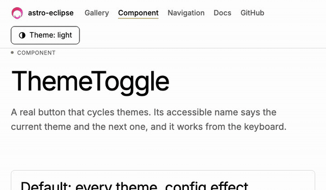
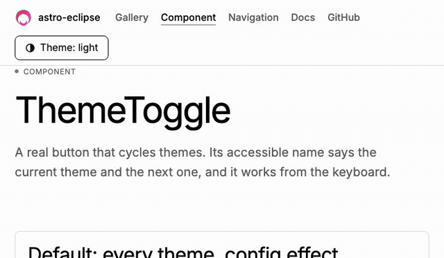
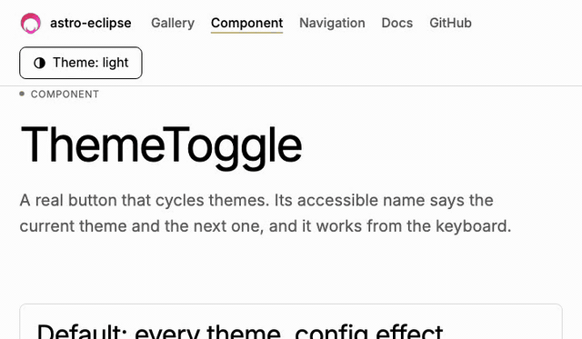
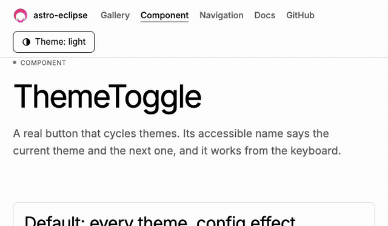
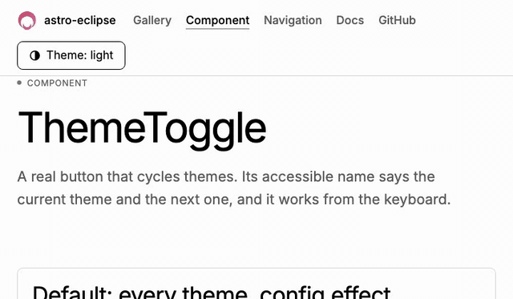

# astro-eclipse

[](https://www.npmjs.com/package/astro-eclipse)
[](https://github.com/jantursky/astro-eclipse/actions/workflows/ci.yml)
[](https://codecov.io/gh/jantursky/astro-eclipse)
[](https://www.npmjs.com/package/astro-eclipse)
[](LICENSE)

[Docs](https://astro-eclipse-docs.vercel.app) · [Demo](https://astro-eclipse.vercel.app) · [npm](https://www.npmjs.com/package/astro-eclipse) · [Changelog](packages/astro-eclipse/CHANGELOG.md)

An Astro integration that switches themes with an animated transition instead of an instant color flip. It works with any number of named themes, stores the choice and follows `prefers-color-scheme`. The theme is set before first paint, on load and on `ClientRouter` navigation, so the page does not flash the wrong one (checked in Chromium and WebKit).

| circle                                             | circle-inverse                                                   | wipe                                             |
| -------------------------------------------------- | ---------------------------------------------------------------- | ------------------------------------------------ |
|    |  |      |
| **diamond**                                        | **iris**                                                         | **blinds**                                       |
|  |                      |  |
| **fade**                                           |                                                                  |                                                  |
|        |                                                                  |                                                  |

Recorded from the demo in Chromium. See [browser support](#browser-support) for what has and has not been checked.

## Install

```sh
npm install astro-eclipse
```

Peer dependency: `astro` `^5.0.0 || ^6.0.0 || ^7.0.0`. No runtime dependencies. ESM only.

## Use

```js
// astro.config.mjs
import { defineConfig } from 'astro/config'
import eclipse from 'astro-eclipse'

export default defineConfig({
  integrations: [
    eclipse({
      themes: ['light', 'dark', 'sepia'],
      default: 'system', // follow prefers-color-scheme until the visitor picks
      transition: 'circle',
      duration: 500,
    }),
  ],
})
```

The library only sets `data-theme="<name>"` on `<html>` (or a class, with `attribute: 'class'`). Colors stay in your CSS:

```css
:root {
  --bg: #fff;
  --fg: #111;
}
[data-theme='dark'] {
  --bg: #000;
  --fg: #eee;
}
[data-theme='sepia'] {
  --bg: #f4ecd8;
  --fg: #3b2f1e;
}
body {
  background: var(--bg);
  color: var(--fg);
}
```

Switch themes from any script or framework island:

```ts
import { setTheme, toggleTheme, getTheme, onThemeChange } from 'astro-eclipse/client'

button.addEventListener('click', (event) => {
  // The reveal starts at the click point.
  setTheme('dark', { transition: 'circle', origin: event })
})

toggleTheme() // next theme in the config order
console.log(getTheme()) // 'dark', never 'system'
const stop = onThemeChange(({ theme, preference }) => console.log(theme, preference))
```

Or use the ready-made button:

```astro
---
import { ThemeToggle } from 'astro-eclipse/components'
---

<ThemeToggle themes={['light', 'dark']} transition="wipe" />
```

## Transitions

| Name             | What it does                                                      | Uses `origin` | Uses `direction` |
| ---------------- | ----------------------------------------------------------------- | ------------- | ---------------- |
| `circle`         | New theme grows as a circle until it covers the screen (default). | yes           | no               |
| `circle-inverse` | Old theme shrinks into the origin.                                | yes           | no               |
| `wipe`           | A straight edge sweeps across.                                    | no            | yes              |
| `diamond`        | New theme grows as a diamond.                                     | yes           | no               |
| `iris`           | New theme opens as a hexagon.                                     | yes           | no               |
| `blinds`         | Eight slats open side by side.                                    | no            | yes              |
| `fade`           | Cross-fade.                                                       | no            | no               |

Every effect takes `duration` and `easing`. Add your own with `defineTransition(name, { old?, new?, top? })`, which returns keyframes for `::view-transition-old(root)` and `::view-transition-new(root)`.

An effect becomes an instant switch when `document.startViewTransition` is missing, when `prefers-reduced-motion: reduce` matches, when the duration is 0, when the name is unknown, or while Astro's `ClientRouter` is navigating. A second `setTheme` during a running effect skips the first one, and the page always ends on the latest choice.

## How it works

1. `src/index.ts` validates your options and calls `injectScript('head-inline', ...)` with a script built from them (`src/head-script.ts`). It also serves the config to the client API as a virtual module (`virtual:astro-eclipse/config`).
2. The inline script runs in `<head>`, before first paint. It reads the choice from `localStorage` (falling back to your `default`, or to `prefers-color-scheme`) and sets the attribute or class. It is about 435 B gzipped and has no dependencies.
3. The same script keeps three things in sync without any client bundle: Astro's `astro:before-swap` (it sets the theme on the incoming document, so a `ClientRouter` page never paints the wrong theme), live `prefers-color-scheme` changes while the choice is `system`, and other tabs through the `storage` event.
4. `astro-eclipse/client` (`src/client/core.ts`) stores the new choice, then applies it inside `document.startViewTransition` (`src/client/runner.ts`). After the browser reports the transition ready, it animates the old and new snapshots with the Web Animations API, using the keyframes of the chosen effect (`src/client/transitions.ts`).
5. The update callback applies whatever is stored when it runs, not what the call asked for. Overlapping calls, in any order, end on the latest choice.
6. While `ClientRouter` navigates (it sets `data-astro-transition` on `<html>`), theme changes are instant, because a second view transition would cancel Astro's own.

## Browser support

The animation needs `document.startViewTransition`. Without it the theme still changes, instantly.

| Browser | `startViewTransition` | Checked on                                                                                                          |
| ------- | --------------------- | ------------------------------------------------------------------------------------------------------------------- |
| Chrome  | 111 (MDN)             | Chromium 156 (Playwright), 2026-11-03: all 7 effects seen mid-transition; end-to-end checks pass                    |
| Edge    | 111 (MDN)             | unverified                                                                                                          |
| Safari  | 18 (MDN)              | WebKit 27.2 (Playwright), 2026-11-03: end-to-end checks pass, animations start; how each effect looks is unverified |
| Firefox | 144 (MDN)             | unverified (the Playwright Firefox build would not start on the test machine; CI runs it)                           |

Versions marked MDN come from [MDN browser compatibility data](https://developer.mozilla.org/en-US/docs/Web/API/Document/startViewTransition#browser_compatibility), not from our tests. The navigation guard relies on the `data-astro-transition` attribute, which is an Astro implementation detail checked against Astro's source and tested on Astro 7 only.

## Prior art

What exists, as read from each project's README. The Astro packages were not run.

| Project                                                                                                  | What it offers                                                                                                     | Animated transition                                        |
| -------------------------------------------------------------------------------------------------------- | ------------------------------------------------------------------------------------------------------------------ | ---------------------------------------------------------- |
| [astro-theme-toggle](https://www.npmjs.com/package/astro-theme-toggle)                                   | `ThemeScript` and `Toggle` components, light/dark                                                                  | One ripple effect                                          |
| [astro-viewtransition-theme](https://www.npmjs.com/package/astro-viewtransition-theme)                   | `ThemeInit` and `ThemeToggle`, light/dark, system aware, multi-toggle sync                                         | No: "view transitions" means ClientRouter support          |
| [astro-themes](https://www.npmjs.com/package/astro-themes)                                               | `<Themes />` component, SSR, any framework                                                                         | Not mentioned                                              |
| [astro-color-scheme](https://www.npmjs.com/package/astro-color-scheme)                                   | `ThemeSwitch` with button, select, checkbox or radio; dark, light, system                                          | Not mentioned                                              |
| [@sjohansson/astro-theme-toggle](https://www.npmjs.com/package/@sjohansson/astro-theme-toggle)           | Five modes (system, light, dark, two high-contrast), Tailwind 4 or plain CSS                                       | Not mentioned                                              |
| [Magic UI animated theme toggler](https://magicui.design/docs/components/animated-theme-toggler)         | React component using View Transitions with clip-path masks (circle, square, polygon, star)                        | Yes, React only (read from search results, not the source) |
| [react-native-nitro-theme-transition](https://github.com/saleh2001k/react-native-nitro-theme-transition) | 16 native effects: circular reveal, iris, slide, split, blinds, blur, pixelize, dissolve, ripple, shatter and more | Yes, React Native only                                     |
| [react-native-theme-transition](https://github.com/marioprieta/react-native-theme-transition)            | 9 styles: fade, circular reveal, heart, star, wipe, slide, split, pixelize, dissolve                               | Yes, React Native only                                     |

The Astro packages cover the toggle and the no-flash script. None of those I read offers several animated effects, more than two named themes with animation, or a way to add your own effect. The React Native libraries set the list of effects people expect, which is where `circle`, `iris`, `wipe`, `blinds` and `fade` come from.

## Not covered yet

- `pixelate`, `dissolve`, `ripple` and `shatter`. They need masks beyond what `clip-path` draws, and I have not prototyped or measured them, so they are not in v1.
- Per-element theme transitions. The effect always covers the whole page.
- Animating a change that comes from another tab or from the operating system. Those switch instantly.
- A live announcement of the new theme. Nothing is announced by default; the [accessibility guide](https://astro-eclipse-docs.vercel.app/guides/accessibility) shows how to add a live region.
- Firefox and Edge are not checked by hand yet (see the table above).

## License

MIT, see [LICENSE](LICENSE).
